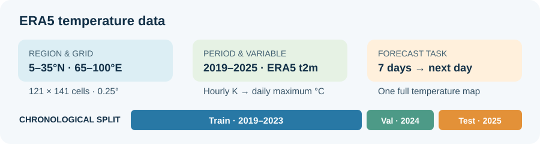
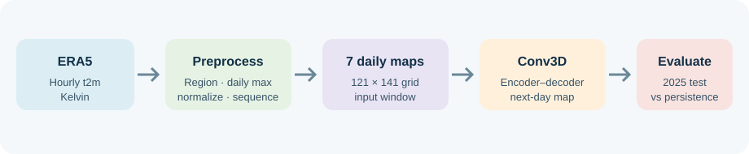

# Regional Next-Day Temperature Forecasting

## Introduction

Reliable temperature information supports planning in agriculture, heat-risk monitoring, energy, and environmental management. This project studies one focused task: predicting tomorrow's daily maximum 2-metre air temperature map from the preceding week's maps over India and nearby areas. It combines an ERA5 data pipeline, deep-learning model comparisons, and an interactive dashboard for exploring predictions.

## Literature Review

ERA5 is a global atmospheric reanalysis that combines model forecasts with observations to provide a consistent historical record (Hersbach et al., 2020). Deep-learning approaches have also been explored for spatiotemporal forecasting. Shi et al. (2015), for example, introduced ConvLSTM for precipitation nowcasting, using convolutional operations within recurrent gates to represent spatial structure and temporal evolution.

This project is related to that broader line of work but its proposed implementation is architecturally different: the class named `ConvLSTMModel` is a Conv3D encoder-decoder and has no recurrent gates or cell state. The project compares it with persistence, LSTM, CNN-LSTM, and Transformer baselines on the same temperature forecasting task.

## Problem Statement

Given seven consecutive daily maximum temperature grids, predict the next day's grid for the study region. The challenge is to retain spatial patterns while learning short-term temporal changes. The central evaluation question is whether the learned model improves on a simple persistence forecast, which assumes tomorrow will match the latest observed day.

## Data Description

- **Source and variable:** ERA5 hourly 2-metre air temperature (`t2m`), originally in Kelvin and converted to degrees Celsius.
- **Exact source period:** 2019-01-01 00:00 through 2025-12-31 23:00 UTC (inclusive; 61,368 hourly records).
- **Region:** 5°–35°N, 65°–100°E, covering India and nearby areas.
- **Grid:** 121 × 141 cells at 0.25° spacing.
- **Daily aggregation:** Maximum of the 24 complete hourly UTC observations for each day.
- **Chronological split:** 2019–2023 for training, 2024 for validation/model selection, and 2025 for testing. Seven-day input windows are created within each split; no window crosses split boundaries.

| Split | Daily data range | Daily maps | Seven-day input/target sequences | Sequence target dates |
|---|---|---:|---:|---|
| Train | 2019-01-01–2023-12-31 | 1,826 | 1,819 | 2019-01-08–2023-12-31 |
| Validation | 2024-01-01–2024-12-31 | 366 | 359 | 2024-01-08–2024-12-31 |
| Test | 2025-01-01–2025-12-31 | 365 | 358 | 2025-01-08–2025-12-31 |

The input tensor contains seven daily grids; its target is the following day's grid. Normalization statistics are estimated from training data. The evaluation uses ERA5-derived targets, so it measures agreement with the reanalysis and is not independent station validation.

The often-quoted **1,089** training samples come from a legacy `outputs/evaluation/train_results.json` artifact. Its original filtering/selection rule cannot be reconstructed, and it does not match the current verified training sequences (1,819). It is stale and is not used in the current comparison.

## Methodology

1. Prepare hourly ERA5 temperature for the selected region and convert units to Celsius.
2. Aggregate complete UTC days to daily maximum temperature maps.
3. Split data chronologically and normalize using training statistics.
4. Create sliding windows of seven input days paired with the next-day target.
5. Train and select learned models using the training and validation periods.
6. Compare selected models against persistence on aligned 2025 test predictions using RMSE, MAE, R², and Pearson correlation.

The proposed implementation's exact data flow is `(B,7,1,121,141) → (B,1,7,121,141)`, then Conv3D `(1→32 channels, 3×3×3 kernel, padding 1)` + ReLU, Conv3D `(32→32, 3×3×3, padding 1)` + ReLU, and Conv3D `(32→1, 3×3×3, padding 1)`. It selects the final temporal slice to return `(B,1,121,141)`. The model has 29,441 trainable parameters and no recurrent gates, hidden state, or cell state. The class/configuration identifier `ConvLSTM` is a legacy name.

The original Figure 3 image/source is not present in the repository, so its baseline architecture cannot be identified or compared layer by layer. If Figure 3 depicts a standard ConvLSTM, that architecture would use convolutional LSTM gates and recurrent hidden/cell states; the proposed code does not. The figure should be redrawn from the implementation and clearly labeled Conv3D encoder-decoder. A specific claim about what the old figure showed would be speculative.

**Novelty statement:** this work does not introduce a new ConvLSTM architecture or a new convolutional recurrent cell. Its contribution is an application-specific, reproducible ERA5 pipeline and evaluation of next-day regional temperature maps, including persistence and neural baselines, a matched input-window ablation, and spatial/seasonal diagnostics. These experiments assess this implementation; they do not establish architectural novelty over prior ConvLSTM work.

Normalization is performed after converting daily maxima from Kelvin to Celsius. A single global mean (25.044549°C) and population standard deviation (10.995944°C) are computed over the training-period grid values only (31,153,386 values), then applied to all splits as `z = (C − mean_train) / std_train`. Predictions are returned to Celsius with `C = z × std_train + mean_train`. Validation/test data do not contribute to these statistics.

Missing or invalid ERA5 values are not filled with synthetic/corrected values: incomplete or non-finite hourly data are rejected, and daily aggregation uses complete 24-hour UTC days. An older all-NaN intermediate file was invalid and excluded from the rebuilt pipeline. Consequently, there is no imputation or claim that erroneous source observations were scientifically corrected; the processed split files were checked for expected dates, finite values, cadence, and dimensions. Exact value-by-value equality of validation/test processed data to the raw source remains unverified.

## Experimental Outcomes

The corrected five-model comparison used seed 42, batch size 16, Adam with learning rate 1e-4, and up to 50 epochs per learned model. Checkpoints were selected by validation loss. **The RMSE, MAE, R², and Pearson r values in the comparison table are calculated on the independent held-out 2025 test set only** (358 aligned forecast-target dates, 2025-01-08 through 2025-12-31). Validation metrics were used for checkpoint selection, not reported as test scores. “Independent” here means held out chronologically from training/model selection; targets are still ERA5 reanalysis, not independent station measurements.

| Model | Test RMSE (°C) | Test MAE (°C) | Test R² |
|---|---:|---:|---:|
| Persistence | 1.403 | 0.897 | 0.982 |
| LSTM | 1.573 | 1.016 | 0.977 |
| CNN-LSTM | 1.401 | 0.899 | 0.982 |
| **Conv3D encoder-decoder** | **1.365** | **0.875** | **0.983** |
| Transformer | 1.403 | 0.899 | 0.982 |

The Conv3D model modestly outperformed persistence in this single-seed, single-test-year comparison. A separate matched-date window ablation found RMSE of 1.368°C, 1.361°C, and 1.359°C for 3-, 7-, and 14-day input histories, respectively; these small differences were not tested for statistical significance.

The 1.8886°C / 1.6200°C / 0.9720 / 0.2477 metric quartet previously quoted in manuscript material is not the current test result. The first two values came from a legacy training artifact; 0.9720 is consistent with a Pearson-correlation value in a legacy test artifact, not its R²; 0.2477 is unsupported by the verified outputs. R² is `1 − SSE/SST`, while Pearson r measures linear association and is invariant to a positive rescaling/offset of predictions. The two statistics are not generally interchangeable, but **R²=0.972 and Pearson r=0.2477 cannot describe the same aligned prediction/target arrays under these standard definitions**: an R² that high requires predictions to track the target closely, which rules out such a low correlation. The old pair therefore indicates mixed splits/artifacts or a calculation/reporting error; the repository evidence cannot determine its exact origin. The current aligned test calculation gives R²=0.982832 and Pearson r=0.991407.

The suitable within-project method comparison is the persistence baseline plus LSTM, CNN-LSTM, Conv3D, and Transformer, all evaluated on the same 2025 targets. The reported test table is the reproducible comparison. Comparisons with published forecasting papers would require matching target definition, region, temporal aggregation, horizon, split, and metric computation; their results are not directly comparable, so no cross-paper score ranking is claimed.

### Input-window ablation (matched dates)

| Past days | Common 2025 targets | RMSE (°C) | MAE (°C) | R² | Pearson r |
|---:|---:|---:|---:|---:|---:|
| Persistence | 351 | 1.395853 | 0.892756 | 0.981761 | 0.990882 |
| 3 | 351 | 1.367838 | 0.873910 | 0.982486 | 0.991278 |
| 7 | 351 | 1.361286 | 0.872670 | 0.982653 | 0.991375 |
| 14 | 351 | 1.358829 | 0.868374 | 0.982716 | 0.991394 |

All learned window models were selected on their validation loss and evaluated on the same dates (2025-01-15–2025-12-31). The small gains with longer windows are descriptive, not statistically significant evidence that longer histories are generally better.

### Spatial and seasonal test errors

The selected Conv3D model's 358 aligned test dates were grouped by season and by grid cell. Seasonal results were: DJF (83 days), RMSE 1.308°C / MAE 0.828°C; MAM (92), 1.494°C / 0.972°C; JJA (92), 1.396°C / 0.905°C; SON (91), 1.242°C / 0.788°C. The unweighted mean of gridpoint RMSEs was 1.176°C; gridpoint RMSE ranged from 0.287°C at 14.75°N, 67.5°E to 5.539°C at 35°N, 100°E. This shows substantial seasonal and geographic variation, including difficult locations. It is a diagnostic over one test year, not proof of robustness across years or regions.

## Discussion

The results suggest that a compact Conv3D model can learn useful short-term spatial and temporal structure from ERA5 temperature maps, but the gain over persistence is limited. Seasonal/spatial errors vary and show localized high-error regions, so the analysis does not support an unqualified claim of spatial or seasonal robustness. The experiment is specific to one region, one target variable, a one-day horizon, and one held-out year. A single random seed does not establish robustness, and reanalysis-based evaluation does not show how the model performs against independent station observations. Multi-year and multi-seed evaluation, independent validation, uncertainty estimates, and additional meteorological inputs are important next steps. The dashboard is useful for inspection and demonstration; it should not be treated as an operational warning service based on these results alone.

## Future Work and Cross-Question Preparation

The following items were not established by this study. If asked, state the limitation directly and describe the next step; do not imply that the missing analysis has already been completed.

| Likely question | Clear answer | Future work |
|---|---|---|
| “What is the exact baseline architecture in Figure 3?” | “I cannot verify it because the original Figure 3 source was not available in the project. Our implemented model is a three-layer Conv3D encoder-decoder, not recurrent ConvLSTM. I would need the original figure or source to identify its baseline precisely.” | Recover the original figure/source, document its layers, and redraw the proposed architecture from code. |
| “Why does the paper mention 1,089 training samples?” | “That number is in a legacy training-results file, but its selection rule cannot be recovered. The verified current pipeline has 1,819 training sequences, so 1,089 is not used in our results.” | Trace the old artifact's generation history if possible; otherwise remove the number from manuscript and presentation materials. |
| “How did you fix missing or wrong ERA5 observations?” | “We did not impute or alter source observations. We reject incomplete/non-finite hourly data and excluded an invalid all-NaN intermediate file. We checked dates, cadence, dimensions, and finite values; exact value-by-value equality of validation and test data to the raw source is still unverified.” | Complete a raw-to-processed value audit for all splits and document any source-data quality-control rules before adding an imputation method. |
| “Was the model validated against weather stations?” | “No. The targets are ERA5 reanalysis values, so this measures agreement with ERA5, not independent observed station temperatures.” | Evaluate against quality-controlled station observations or another independent product, with clear spatial and temporal matching. |
| “Does one test year prove the model is robust?” | “No. We have one held-out year and one seed. The seasonal and spatial breakdown describes that test year, but does not establish robustness across years or regions.” | Repeat with multiple seeds and additional held-out years/regions; report uncertainty intervals and significance tests. |
| “Is the improvement over persistence statistically significant?” | “We have not tested statistical significance. Conv3D's RMSE is modestly lower in this run, but the comparison is descriptive.” | Use paired date-wise error comparisons, resampling or other suitable statistical tests, and repeated seeds. |
| “Can it forecast months or a year ahead?” | “The reported experiment predicts one day ahead. Longer autoregressive predictions may be available in the application, but they are not validated by these test metrics.” | Evaluate each forecast lead separately, quantify error growth and uncertainty, and compare against appropriate climatology and persistence baselines. |
| “What is novel about this compared with ConvLSTM research?” | “We do not claim a new ConvLSTM architecture. The implemented model is Conv3D. The contribution is this regional ERA5 forecasting pipeline and its same-task baseline, window-ablation, and error analyses.” | Establish a carefully matched comparison with prior work and retain the limited, application-specific contribution claim unless new methodological work supports a stronger one. |
| “Why not compare with numerical weather prediction or more published methods?” | “We compared persistence, LSTM, CNN-LSTM, Conv3D, and Transformer on aligned test dates. We did not run numerical weather prediction systems or claim direct ranking against published studies because their regions, targets, horizons, and protocols differ.” | Add suitable operational baselines and cross-paper comparisons only when data and evaluation protocols can be matched transparently. |
| “How can R² be 0.972 while correlation is 0.2477?” | “Those values cannot describe the same aligned arrays under the standard calculations. The old pair came from inconsistent or unsupported artifacts. In our corrected test run, R² is 0.982832 and Pearson r is 0.991407.” | Keep R² and Pearson r separately labeled, compute both in one evaluation routine, and remove the unsupported legacy pair. |

**Short answer to a broad limitations question:** “This is a one-day-ahead, single-region ERA5 experiment. The internal comparison and error diagnostics are complete, but independent station validation, multi-year/multi-seed robustness, statistical significance, long-lead evaluation, and recovery of some legacy manuscript details remain future work.”

## Conclusion

This project developed and evaluated a pipeline for next-day regional temperature-map prediction using seven days of ERA5 history. The proposed Conv3D encoder-decoder achieved 1.365°C test RMSE and 0.875°C test MAE for 2025, a modest improvement over persistence. The finding is promising for this defined experiment, while broader validation is needed before making claims about other regions, independent observations, or longer forecast horizons.

### Conference talk track

“We developed a regional next-day temperature forecasting pipeline using ERA5 data. The model takes seven daily temperature maps and predicts the next map across a 121-by-141 grid covering India and nearby areas. On held-out 2025 data, our Conv3D encoder-decoder reached an RMSE of about 1.36 degrees Celsius, modestly improving on a persistence baseline. This is an initial result for a one-day-ahead reanalysis-based task, and we are continuing validation across years and independent observations.”

## References

1. Hersbach, H., Bell, B., Berrisford, P., et al. (2020). The ERA5 global reanalysis. *Quarterly Journal of the Royal Meteorological Society, 146*(730), 1999–2049. [https://doi.org/10.1002/qj.3803](https://doi.org/10.1002/qj.3803)
2. Shi, X., Chen, Z., Wang, H., Yeung, D.-Y., Wong, W.-K., & Woo, W.-C. (2015). Convolutional LSTM Network: A Machine Learning Approach for Precipitation Nowcasting. *Advances in Neural Information Processing Systems 28*. [NeurIPS paper](https://papers.nips.cc/paper/2015/hash/07563a3fe3bbe7e3ba84431ad9d055af-Abstract.html)
3. Project implementation and verified experiment details: [README.md](README.md), [models/convlstm.py](models/convlstm.py), and [run_baseline_experiments.py](run_baseline_experiments.py).
